# whereismyslice
Localize human brain histology sections in 3D MRI space with cross-modal embeddings. Trained on synthetic pairs from reslicing BigBrain + MRI at random oblique angles (no manual labels). Retrieves matching MRI slices and flags misordered, flipped or damaged sections. Like DeepSlice, but for human brains. Test it on DHARANI and Next brain.
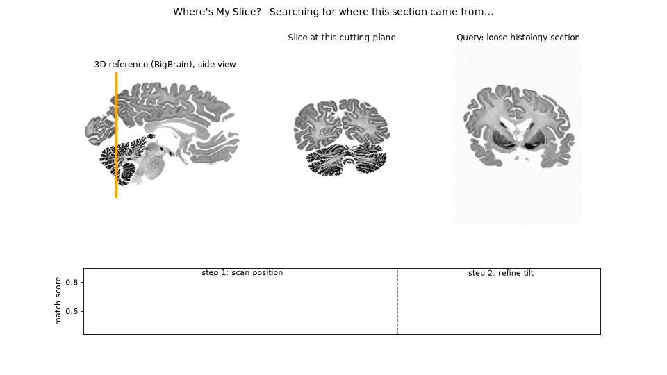
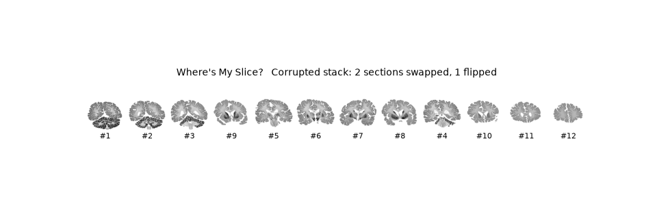

BigBrain Hack 2026 · Sudha Gopalakrishnan Brain Centre (SGBC), IIT Madras

## What it does

Given a histology section, or a small piece of one, find where it sits in a 3D brain MRI:

1. **Which plane**: position along the brain and cutting angle (any oblique angle, any in-plane rotation).
2. **Where in that plane**: shift, rotation, scale and shear.
3. **How it is damaged**: tears, cuts and stretching, undone by a regularised deformation.

Two method families share one GPU plane sampler and one evaluation:

* **Classical**: coarse search over planes (FFT correlation of tissue outlines, stain-independent), gradient
  refinement of all 7 pose numbers with mutual information, then a regularised deformation.
* **Learned**: a dual encoder (shared DINOv2 backbone, one head for histology and one for MRI) trained on
  resliced histology/MRI pairs proposes candidate planes; a JEPA-style model finds small histology pieces inside an
  MRI slice. Training pairs come free from reslicing the aligned BigBrain histology and MRI volumes.

## Results

All results are on public data (BigBrain 2015 release, SbR paired datasets) and on one brain so far.

### A histology section cut at an oblique angle → its full pose in the MRI

Sections cut 0–45° off coronal and rotated anywhere through 360°, searched in the 3D MRI with no hint.
**39 of 40** recovered with angle and rotation within 5° and alignment within 2 mm; typical errors
**0.4°, 0.4° and 0.4 mm**, about 12 s each.

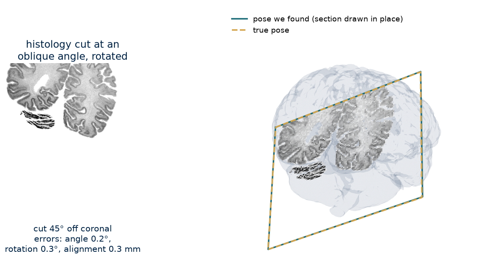

| cut off coronal | 0° | 15° | 30° | 45° |
|---|---|---|---|---|
| recovered | 10/10 | 10/10 | 9/10 | 10/10 |

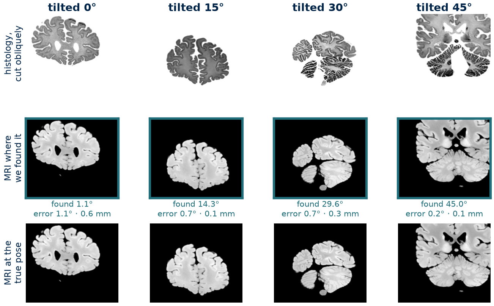

### A cut piece of histology → its location inside the MRI

A real 3 cm histology piece is located in the 3D MRI in two steps, both histology → MRI: its parent section is
placed in the MRI (the slice), then the piece is matched to MRI features in that slice (the spot).

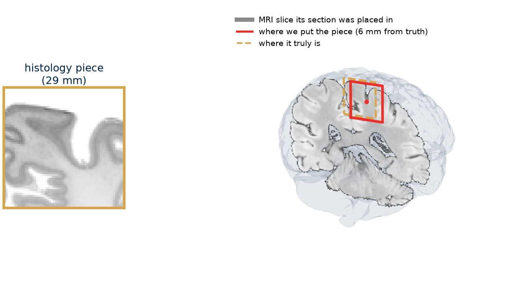
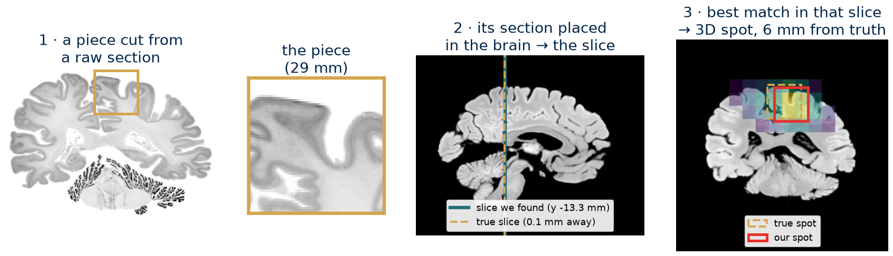

| real pieces (~28 mm), within 10 mm | clean | damaged |
|---|---|---|
| template matching, in its own slice | 30 % | 20 % |
| off-the-shelf DINOv2, in its own slice | 12 % | 0 % |
| **JEPA, in its own slice** | **85 %** | 48 % |
| piece alone, whole brain | 55 % | 29 % |
| parent section first, then JEPA in that slice | 80 % | 52 % |
| **parent section first, then the piece found in its own section** | **98 %** | **99 %** |

With its parent section available, the piece is found inside that section (same contrast, nearly exact) and carried
into the MRI through the section's in-plane alignment: typical error **0.8 mm** (clean) and 1.1 mm (damaged), 82 %
and 78 % within 2 mm, 320 real pieces. Without a section, the piece-alone route applies.

### Which MRI slice does a raw section belong to?

344 raw SbR BigBrain sections. Found in the histology volume first, the MRI slice is read off:
**89 % within one MRI slice (0.4 mm)**, typical error 0.24 mm. Similarity to neighbouring MRI planes peaks at the
true slice. Found on the way: the SbR slice numbering is 1.0 mm off, the offset of the released BigBrain MRI.

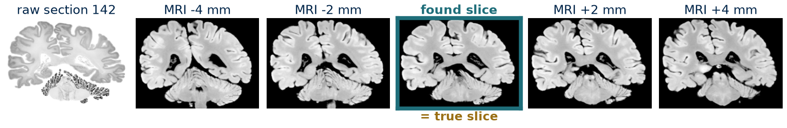
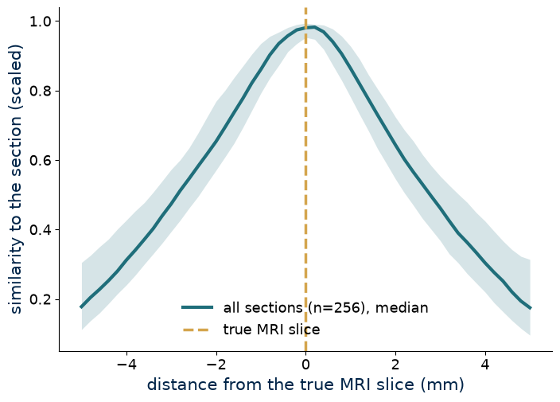

### Where in its MRI slice: as good as the expert reference

Raw sections placed inside their MRI slice from scratch: **0.41 mm** from the reference, **100 %** within 2 mm on
the 256 sections with a reliable reference, tissue overlap 0.92 vs 0.92. On edge sections where the reference fails,
ours lines up (red = histology, cyan = MRI, top = reference, bottom = ours):

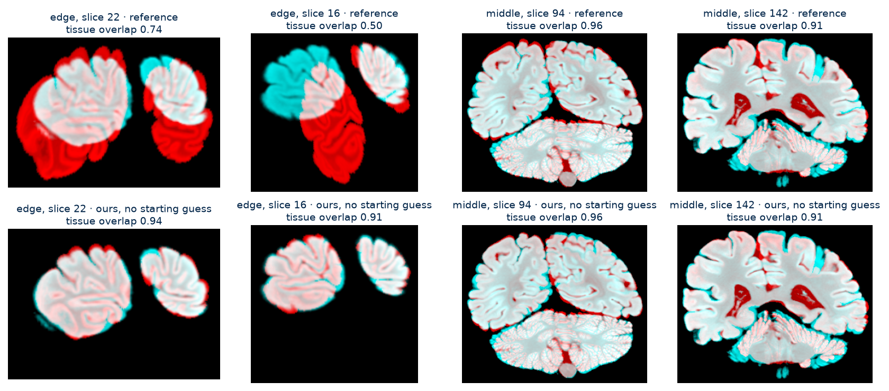

### Whole real sections in 3D

69 real BigBrain sections found in the MRI with no prior: **0.10 mm** typical distance from the true plane, 100 %
within 2 mm, ~1.4 s each. The measured spacing between sections is 20.00 µm, the true cutting thickness.

### Robustness to damage

Real sections damaged on purpose with an exact known pixel mapping. Rotation and 10 % stretch do not move the
answer (0.05 mm); cuts and warps are halved by the new deformation (cuts 0.65 → 0.30 mm, 10 % warp 2.45 → 1.58 mm).

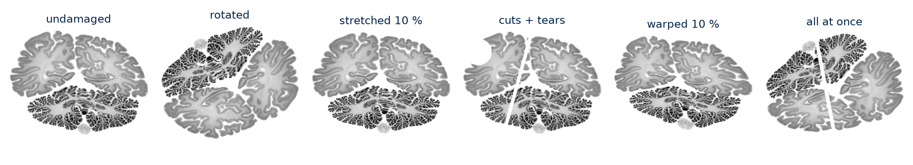

### Training the dual encoder

3,000 steps × 64 pairs = 192,000 resliced histology/MRI pairs with stain, tear, cut, blur and shrinkage artefacts,
in about 10 minutes on a laptop GPU. On a brain slab never used in training, the right plane is within 2 mm for
**0 % → 94 %** of held-out sections; on real sections there, 9 of 10 are ranked first within 3 mm.

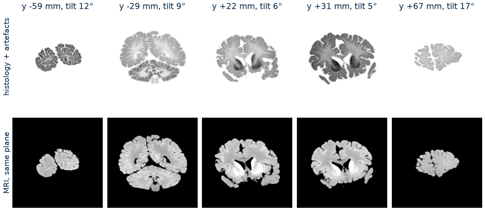

## Limitations

* One brain (BigBrain) so far; other brains (ICBM152, NextBrain, DHARANI) are next.
* Oblique test sections are resliced from the BigBrain volume (exact truth), not independently cut.
* Fully sagittal or axial (90°) cuts are not covered by the current search grid.
* Damaged small pieces remain hard (about half the hit rate of clean ones).

## Run it

```bash
uv sync                                   # Python 3.12, torch (CUDA 12.8), timm, SimpleITK, ANTsPy, faiss
bash scripts/download_data.sh             # BigBrain histology + MRI (ftp.bigbrainproject.org, CC BY 4.0)
uv run python scripts/02_fix_mri_offset.py
uv run python scripts/06_train_dual_encoder.py      # ~10 min
uv run python scripts/12_train_patch_jepa.py        # ~10 min
uv run python scripts/19_oblique_test.py            # and the other numbered scripts
uv run pytest tests
```

The SbR data is a sparse clone of [acasamitjana/SynthByReg](https://github.com/acasamitjana/SynthByReg) `data/`
in `data/sbr/repo`. Data, checkpoints and the virtual environment are not in this repository.
`docs/NOTES.md` has the full working notes: every script, every result table and caveat.

## Layout

* `src/wms/`: plane sampler, classical registration, in-plane alignment and deformation, embeddings, dual encoder,
  JEPA patch model, synthetic damage
* `scripts/01–25`: numbered experiments, each writing `results/*.csv` and `figures/*.png`
* `tests/`: sampler and patch-search tests

Data: BigBrain Release 2015 (CC BY 4.0); SbR: Casamitjana et al. 2021.
